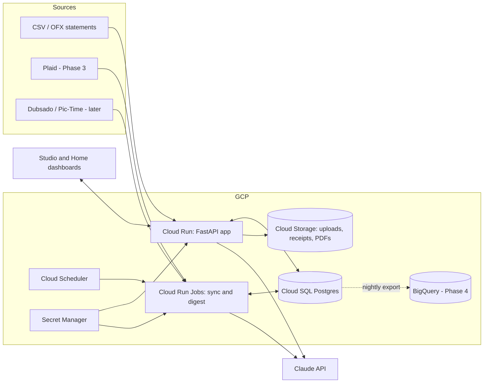
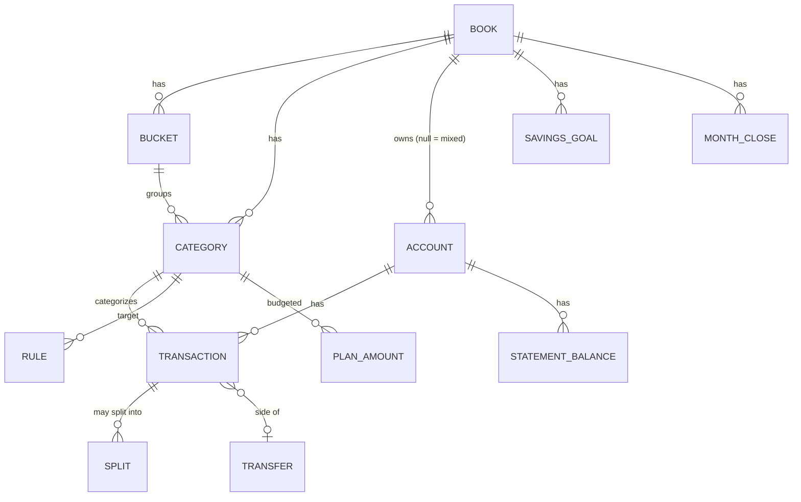

# Backend Flow

How money data moves through the system, what is stored, and which endpoints the UI will use. Design only, no code yet.

## Architecture

## Pipeline, step by step

Each new transaction moves through these steps once. A transaction's **status** is one of
`auto` (sorted by the tool), `suggested` (a best guess she confirms), `needs_you` (a question for her) or `done` (she answered).
"Sorted" means `auto` or `done`.

1. **Ingest.** A CSV/OFX upload or a Plaid sync produces raw rows. Each source is an adapter with the same output shape: account, date, description, signed amount (positive = money in). Each bank gets a saved column mapping (date column, description column, either one amount column or separate debit/credit columns, and whether charges are exported as positive numbers).
2. **Normalize.** Clean the merchant name: `TARGET 00012` → `TARGET`, `ADOBE *CREATIVE CLOUD` → `ADOBE CREATIVE CLOUD`. Also flag rows that look like transfers (`PAYMENT THANK YOU`, `TRANSFER TO …`).
3. **Dedupe.** Hash of account + date + amount + description + occurrence number within the file. Re-importing the same statement is harmless.
4. **Transfer matching.** Pair an outflow and an inflow of the same amount in two of her accounts, within ±3 days, choosing the closest dates first. The pair type decides what happens:
   - **Card payment** (checking → credit card): both sides are excluded from spending, so purchases aren't counted twice.
   - **Same-book transfer** (checking → savings): excluded from spending. If the destination account is tied to a goal category (Tax Savings → "Tax savings"), the outflow counts toward that set-aside.
   - **Owner's-pay bridge** (studio checking → home checking): the studio side is categorized as **Owner's pay to home** (a Set-aside, not a business expense). The home side is categorized as **Studio owner's pay** (income). Both are marked `auto` and linked, so the two books always agree.
5. **Rules.** Her saved answers, such as "merchant contains ADOBE, money out → Software & subscriptions." A rule can also say which book a merchant belongs to, which settles mixed-card questions. The most specific (longest) pattern wins. A match sets status `auto`.
6. **Suggestions.** For anything still unsorted:
   - First, her past answers for the same merchant that weren't saved as rules.
   - Second, the Claude API, given the merchant, amount, date, account, her category list and context (calendar events, Dubsado invoices when available). It returns a category, a confidence and a one-line reason.
   - A suggestion sets `suggested`. Low confidence, or a mixed account with no book known, sets `needs_you` with a plain question ("Studio or home?").
   - **Suggestions never auto-apply.** Only rules do.
7. **Review queue.** She works through `needs_you` and `suggested` items (cards, rows or the paper packet). Each answer can:
   - Set a category (which also sets the book).
   - Split the transaction across categories and/or books. The amounts must add up to the total.
   - Optionally "always do this," which creates a rule.
8. **Month close checks** (per book):
   - Every transaction in the month is sorted.
   - Every transaction flagged as a transfer is matched or explained.
   - Each account's computed balance (opening balance + transactions) equals the statement closing balance she enters, or that Plaid reports.
   - Optional: receipts attached for anything over a threshold.
   When everything passes, the month is closed and locked. Edits after that require reopening the month, which is logged.
9. **Reports.**
   - Plan vs. actual by category and bucket.
   - "Left to assign" (zero-based: planned income minus all planned categories).
   - Studio P&L and 30% tax set-aside estimate.
   - Slow-season reserve balance.
   - "Saving for" progress and projected purchase month.
   - Net worth (home).
   - Quarterly letter (LLM-written from the computed numbers only).

## Data model

| Table | Key fields |
|---|---|
| **book** | key (`home`, `studio`), name |
| **bucket** | book, key (`ess`, `non`, `goal`), name: Home = Essentials / Non-essentials / Financial goals; Studio = Running costs / Growth / Set-asides |
| **category** | book, bucket (null for income), name, kind (`income`, `expense`, `goal`), schedule_c_line (studio only) |
| **account** | name, type (`checking`, `savings`, `credit_card`, `loan`, `investment`), book (null = mixed), last4, goal_category (e.g. Tax Savings → Tax savings), opening_balance, opening_date, source (`csv`, `plaid`) |
| **transaction** | account, posted_on, raw_description, merchant, amount_cents (signed), dedupe_hash (unique), status, book, category, transfer_id, looks_like_transfer, suggestion (category, confidence, reason), note |
| **split** | transaction, book, category, amount_cents |
| **transfer** | out_txn, in_txn, kind (`card_payment`, `transfer`, `owners_pay`) |
| **rule** | pattern, direction (in / out / any), book, category, created_from_txn, hit_count |
| **plan_amount** | category, month (`YYYY-MM`), amount_cents. Studio plans vary by month with the season. |
| **savings_goal** | book, name, cost, saved, monthly_contribution, priority, purchased_on, note. Projected purchase month = this month + ceil((cost − saved) / monthly). |
| **statement_balance** | account, month, closing_balance_cents |
| **month_close** | book, month, closed_at, checklist snapshot (JSON), reopened_at |

Money is stored as **integer cents**. The amount sign is from the account's point of view: + is money in, − is money out. For cards, − is a charge.

### Studio categories → Schedule C (starting point for the CPA to confirm)

| Category | Line |
|---|---|
| Weddings, Sessions, Second shooting for others, Print & album sales | 1 (gross receipts) |
| Albums & prints | Part III, cost of goods sold |
| Marketing & ads | 8 |
| Mileage & gas | 9 (or standard mileage) |
| Second shooters | 11 (contract labor, 1099-NEC list) |
| Gear | 13 / Section 179 (the CPA decides) |
| Insurance | 15 |
| Software & subscriptions, Card & gallery fees, Education | 18 / 27a |
| Travel (lodging, flights) | 24a |
| Meals with clients | 24b (50%) |
| Phone & internet | 25 |
| Owner's pay, Tax savings, Solo 401(k), Saving for, Slow-season reserve | Not deductible on Schedule C. These are set-asides. |

## API surface (Phase 1)

- `GET /books`, `GET /categories?book=`, and create/update/archive categories
- `GET /accounts`, `POST /accounts`, `PATCH /accounts/{id}`
- `POST /accounts/{id}/import`: upload CSV/OFX, run the pipeline, return counts (imported, duplicates, auto, suggested, needs_you)
- `GET /review?book=&month=`: the queue (`needs_you` first, then `suggested`)
- `POST /transactions/{id}/answer` (category, optional "make rule")
- `POST /transactions/{id}/confirm` (accept suggestion)
- `POST /transactions/{id}/split` (parts)
- `GET /transactions?book=&month=&status=`: the log view
- `GET /rules`, `DELETE /rules/{id}`
- `GET /plan/{book}/{month}`, `PUT /plan/{book}/{month}`, `POST /plan/{book}/{month}/copy-from/{month}`
- `GET /reports/{book}/{month}/plan-vs-actual`, `GET /reports/{book}/{year}/annual`, `GET /reports/studio/{year}/pnl`, `GET /reports/studio/{year}/taxes`, `GET /reports/home/net-worth`
- `GET/POST/PATCH/DELETE /savings-goals`, `GET /savings-goals/progress?book=`
- `PUT /accounts/{id}/statements/{month}` (closing balance)
- `GET /close/{book}/{month}` (checklist), `POST /close/{book}/{month}`, `POST /close/{book}/{month}/reopen`

## Scheduled jobs (Cloud Scheduler → Cloud Run Jobs)

| Job | When | What |
|---|---|---|
| `sync-banks` | Nightly (Phase 3) | Plaid pull → pipeline |
| `month-start` | 1st of the month, morning | Copy last month's plan as a draft; tell her "September is ready to close: 8 items" |
| `weekly-digest` | Her chosen day/time | One message: items waiting, safe-to-spend, upcoming bills |
| `tax-reminders` | 2 weeks before Apr 15, Jun 15, Sep 15, Jan 15 | Estimated payment amount and tax savings balance |
| `export-bq` | Nightly (Phase 4) | Copy tables to BigQuery |
| `backup-check` | Weekly | Confirm Cloud SQL backups exist and restore-test monthly |
