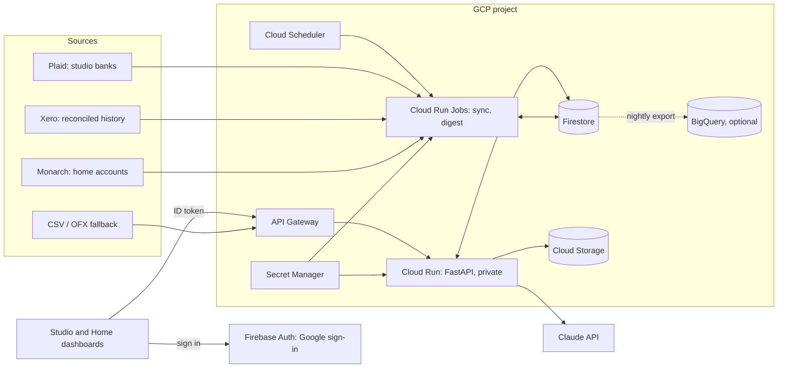

# Backend Flow

How money data moves through the system, what is stored, and which endpoints the UI will use. Design only, no code yet.

## Architecture

## Data sources

### Studio: Plaid (Trial plan)

- **Coverage check first.** Before linking, look up each institution with Plaid's institution search in the free Sandbox environment and confirm it supports the Transactions product. Payment apps (PayPal, Venmo, Square) are the usual gaps; those stay on CSV, or Stripe's own free API if needed.
- **Linking.** A one-time "Connect a bank" page uses Plaid Link. Each bank login becomes one Plaid Item, which covers every account at that bank. The Trial allows 10 Items, and removing an Item doesn't free a slot, so we link each bank once and use Plaid's update mode to re-authenticate instead of re-linking.
- **History.** Request the longest history at link time (up to 24 months) so it overlaps everything already reconciled in Xero.
- **Sync.** Nightly `/transactions/sync` per Item with a saved cursor. Added, modified and removed transactions are all applied, so pending charges that settle don't duplicate. No webhooks needed: nightly polling is simpler and enough.

### Studio: Xero reconciled history

Xero's API only returns bank lines she has already reconciled; unreconciled feed lines aren't available. That's exactly what we want from it: her finished work.

1. **Connect.** A Xero app on the free Starter tier, OAuth 2.0 with read-only accounting scopes (exact scope names per Xero's current docs) and a refresh token kept in Secret Manager.
2. **Map once, with her.**
   - Xero bank accounts → our accounts (matched by account number, confirmed by her).
   - Xero chart of accounts codes → our studio categories. A one-time mapping screen. Most map one-to-one; anything unclear gets a plain question.
3. **Pull.**
   - `Accounts`: chart of accounts and bank accounts.
   - `BankTransactions` where reconciled: spend and receive money. Each line item's account code becomes a category; several line items become a split.
   - `BankTransfers`: become matched transfers.
   - `Payments`: invoice and bill payments that were reconciled.
   - Later runs use `If-Modified-Since`, so only new or changed records come back.
4. **Store.** Imported as `done`, `source = xero`, with the Xero ID kept for traceability. Never re-sorted by our rules.
5. **Learn.** For each merchant/contact seen at least 3 times and categorized the same way at least 90% of the time, propose a rule. She sees the list once ("Adobe → Software & subscriptions, 14 times") and approves or edits it. Nothing is applied without that approval.
6. **"Reconciled through" date.** Per account, the latest reconciled line's date. Shown in the Snapshot tab so she can see where Xero's work ends and the tool's begins.
7. **While she still uses Xero.** The pull runs nightly. If she reconciles something in Xero, our copy picks up her category instead of asking again. After the CPA decision, this either stops (Xero cancelled) or reverses direction (we push sorted transactions into Xero).

### Overlap: Plaid and Xero describe the same money

Plaid's history backfill covers months Xero already has, so every Plaid transaction is checked against Xero first:

- **Match** on the same account, the exact amount, and a date within ±3 days, with merchant-name similarity as the tie-breaker. Closest date wins, and each line can match only once.
- **Matched:** the Plaid transaction takes the Xero category and status `done`, links to the Xero ID, and is never shown to her.
- **In Plaid, in a reconciled period, but not in Xero:** flagged for a quick look. It's usually something skipped or deleted in Xero.
- **In Xero but not in Plaid:** kept as is, for example cash or manual entries.
- **After the "reconciled through" date:** goes through the normal pipeline below.

### Home: Monarch

- Nightly job using `monarchmoneycommunity` (unofficial). Credentials and the MFA secret are kept in Secret Manager, and the session token is cached to avoid repeated logins.
- Pulls accounts, balances and transactions. Monarch's own category comes along as a suggestion, mapped to our home categories through a one-time mapping, the same way as Xero.
- If the library breaks, the job reports it in the weekly digest, and the fallback is Monarch's CSV download uploaded into the same import step.

## Pipeline, step by step

Each new transaction moves through these steps once. Its **status** is one of `auto` (sorted by the tool), `suggested` (a best guess she confirms), `needs_you` (a question for her) or `done` (answered by her, or imported from Xero).

1. **Ingest.** Every source adapter (Plaid, Xero, Monarch, CSV/OFX) produces the same shape: account, date, description, signed amount (+ is money in), external ID, and optional source category.
2. **Normalize.** Clean the merchant name (`ADOBE *CREATIVE CLOUD` → `ADOBE CREATIVE CLOUD`) and flag rows that look like transfers.
3. **Dedupe.** The document ID is a hash of source + external ID, or of account + date + amount + description for CSVs. Re-importing is harmless.
4. **Xero overlap.** Studio transactions dated on or before the account's "reconciled through" date are matched against Xero lines as described above.
5. **Transfer matching.** Pair an outflow and an inflow of the same amount in two of our accounts within ±3 days.
   - **Card payment** (checking → card): excluded from spending, so purchases aren't counted twice.
   - **Same-book transfer** (checking → savings): excluded from spending. If the destination is tied to a goal (Tax Savings), it counts toward that set-aside.
   - **Owner's-pay bridge** (studio checking → home checking): the studio side becomes **Owner's pay to home** (a set-aside, not an expense). The home side becomes **Studio owner's pay** (income). Both are linked and `auto`. This is the one place where Plaid (studio) and Monarch (home) data meet.
6. **Rules.** Her approved rules (including the ones learned from Xero). The most specific pattern wins. A match sets `auto`.
7. **Suggestions.** For anything still unsorted: her past answers for the same merchant, then Monarch's category (home), then the Claude API. A suggestion sets `suggested`. Low confidence, or a mixed card with no book known, sets `needs_you` with a plain question. **Suggestions never auto-apply.**
8. **Review queue.** She answers `needs_you` and confirms `suggested`. An answer can split a transaction across categories or books, and can optionally become a rule.
9. **Month close** (per book): every transaction sorted; every transfer matched; each account's computed balance equals the balance Plaid or Monarch reports for month end (or the statement balance she types in for CSV accounts). When everything passes, the month is locked. Reopening is logged.
10. **Summaries.** After every change, recompute that book's month summary document (totals by category and bucket). Dashboards read these small documents instead of every transaction, which keeps Firestore reads tiny.

## Data model (Firestore)

All money is stored as **integer cents**, signed from the account's point of view (+ in, − out; for cards, − is a charge).

| Collection | Document ID | Key fields |
|---|---|---|
| `books` | `home`, `studio` | name, buckets (key, name, order) |
| `categories` | auto | book, bucket, name, kind (`income` / `expense` / `goal`), schedule_c_line (studio), archived |
| `accounts` | auto | name, type (`checking` / `savings` / `credit_card` / `loan` / `investment`), book (or `mixed`), last4, source (`plaid` / `monarch` / `csv`), external IDs (Plaid account, Xero account, Monarch account), goal_category, reconciled_through |
| `transactions` | hash | account, posted_on, month (`YYYY-MM`), merchant, raw_description, amount_cents, book, category, status, splits (embedded list of book + category + amount), transfer_id, source, external IDs (Plaid / Xero / Monarch), suggestion (category, confidence, reason), note |
| `transfers` | auto | out_txn, in_txn, kind (`card_payment` / `transfer` / `owners_pay`) |
| `rules` | auto | pattern, direction, book, category, origin (`answer` / `xero_history`), approved, hit_count |
| `plans` | `{book}_{YYYY-MM}` | amounts: map of category → cents. Studio plans vary by season. |
| `savings_goals` | auto | book, name, cost, saved, monthly, priority, purchased_on, note. Ready month = this month + ceil((cost − saved) / monthly). |
| `statements` | `{account}_{YYYY-MM}` | closing_balance_cents, source (`plaid` / `monarch` / `typed`) |
| `month_closes` | `{book}_{YYYY-MM}` | closed_at, checklist snapshot, reopened_at |
| `summaries` | `{book}_{YYYY-MM}` | totals by category and bucket, counts by status |
| `mappings` | `xero_accounts`, `xero_categories`, `monarch_categories` | source ID → our ID |
| `sync_state` | per source / Plaid Item | cursor, last run, last error, item status (`ok` / `needs_reauth`) |

**Indexes:** `transactions` on (book, month, status) and (account, posted_on).

**Secrets are never stored in Firestore.** Plaid access tokens, the Xero refresh token and Monarch credentials live in Secret Manager.

### Studio categories → Schedule C (starting point for the CPA to confirm)

| Category | Line |
|---|---|
| Weddings, Sessions, Second shooting for others, Print & album sales | 1 (gross receipts) |
| Albums & prints | Part III, cost of goods sold |
| Marketing & ads | 8 |
| Mileage & gas | 9 (or standard mileage) |
| Second shooters | 11 (contract labor, 1099-NEC list) |
| Gear | 13 / Section 179 (the CPA decides) |
| Insurance | 15 |
| Software & subscriptions, Card & gallery fees, Education | 18 / 27a |
| Travel (lodging, flights) | 24a |
| Meals with clients | 24b (50%) |
| Phone & internet | 25 |
| Owner's pay, Tax savings, Solo 401(k), Saving for, Slow-season reserve | Not deductible. These are set-asides. |

## API surface (through API Gateway, all require sign-in)

- **Setup:** `GET /books`, `GET/POST/PATCH /categories`, `GET/POST/PATCH /accounts`
- **Connections:** `POST /plaid/link-token`, `POST /plaid/exchange` (finish linking a bank), `GET /connections` (status of every source), `POST /xero/connect` and `GET /xero/callback` (OAuth), `GET/PUT /mappings/{name}`, `GET /rules/proposed`, `POST /rules/proposed/approve`
- **Import:** `POST /accounts/{id}/import` (CSV/OFX fallback)
- **Review:** `GET /review?book=&month=`, `POST /transactions/{id}/answer`, `POST /transactions/{id}/confirm`, `POST /transactions/{id}/split`, `GET /transactions?book=&month=&status=`
- **Rules:** `GET /rules`, `DELETE /rules/{id}`
- **Plans:** `GET/PUT /plan/{book}/{month}`, `POST /plan/{book}/{month}/copy-from/{month}`
- **Saving for:** `GET/POST/PATCH/DELETE /savings-goals`
- **Reports:** `GET /reports/{book}/{month}`, `GET /reports/{book}/{year}/annual`, `GET /reports/studio/{year}/taxes`, `GET /reports/home/net-worth`
- **Close:** `GET /close/{book}/{month}`, `POST /close/{book}/{month}`, `POST /close/{book}/{month}/reopen`
- **Export:** `GET /export/{book}/{year}.csv` (no lock-in)

## Scheduled jobs (Cloud Scheduler → Cloud Run Jobs)

Cloud Scheduler gives 3 free jobs, so the nightly work runs as one job with steps.

| Job | When | What |
|---|---|---|
| `nightly-sync` | Every night | Xero pull (while in use) → Plaid sync → Monarch sync → pipeline → summaries. Records failures in `sync_state`. |
| `month-start` | 1st of the month | Draft next month's plan from last month; tell her "October is ready to close: 8 items." |
| `weekly-digest` | Her chosen day and time | Items waiting, safe-to-spend, upcoming bills, any connection that needs re-linking, and tax reminders in the two weeks before Apr 15, Jun 15, Sep 15 and Jan 15. |
