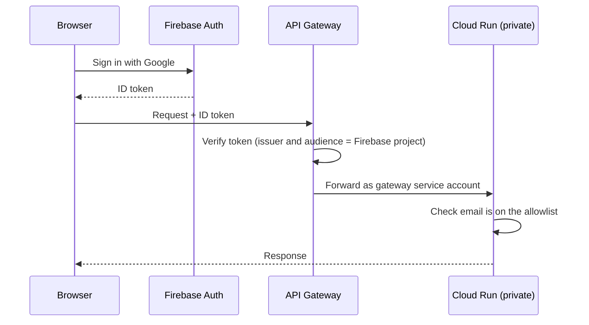

# Environment Setup Plan

Everything to put in place before the first line of code. You can follow it as a checklist. The goal is to stay inside free tiers.

## GCP project

One project, `money-prod`, in its own folder or on its own billing account away from work projects. Development runs locally against the Firebase emulators, so no second cloud project is needed.

Set a **budget alert at $5/month** with email notifications at 50%, 90% and 100%.

Region: `us-central1` (free-tier eligible for Cloud Storage, Cloud Run and Firestore).

## Services to enable

```
run.googleapis.com
firestore.googleapis.com
apigateway.googleapis.com
servicemanagement.googleapis.com
servicecontrol.googleapis.com
secretmanager.googleapis.com
cloudscheduler.googleapis.com
artifactregistry.googleapis.com
storage.googleapis.com
iamcredentials.googleapis.com      # Workload Identity Federation for GitHub
identitytoolkit.googleapis.com     # Firebase Authentication
bigquery.googleapis.com            # optional, later
```

Add Firebase to the project (Firebase console → Add project → choose the existing GCP project). Firestore in **Native mode**, location `us-central1`, using the free `(default)` database.

## Sign-in and the front door



- **Firebase Authentication:** enable the Google provider. Only Google sign-in, no passwords.
- **API Gateway:** an OpenAPI config with Firebase as the security definition, so requests without a valid token never reach the app.
- **Cloud Run:** ingress `all`, but **no unauthenticated access**. Only the gateway's service account has the Run Invoker role. The app also checks the signed-in email against an allowlist of our two addresses (kept as an environment variable, not in the repo).
- **Web front end (Phase 2):** Firebase Hosting (free tier) or the same Cloud Run service.

## Service accounts

| Service account | Used by | Roles |
|---|---|---|
| `money-app` | Cloud Run service and jobs | Cloud Datastore User (Firestore), Secret Manager Secret Accessor (only its secrets), Storage Object Admin on the app bucket |
| `money-gateway` | API Gateway | Cloud Run Invoker on `money-api` |
| `money-scheduler` | Cloud Scheduler | Cloud Run Invoker on the jobs |
| `github-deployer` | GitHub Actions via Workload Identity Federation (no JSON keys) | Artifact Registry Writer, Cloud Run Developer, Service Account User on `money-app`, API Gateway Admin |

People: you as Owner. She gets **no GCP access**, only the app.

## Secrets (Secret Manager, names only)

| Secret | When |
|---|---|
| `allowed-emails` | Phase 0 |
| `plaid-client-id`, `plaid-secret` | Phase 1 |
| `plaid-token-{bank}` (one per linked bank) | Phase 1 |
| `xero-client-id`, `xero-client-secret`, `xero-refresh-token` | Phase 1 |
| `monarch-email`, `monarch-password`, `monarch-mfa-secret` | Phase 1 |
| `anthropic-api-key` | Phase 3 |

Never commit secrets. Locally, use a git-ignored `.env` file and Plaid's Sandbox keys.

## Cloud Run

- Service `money-api` (FastAPI). Min instances 0, max 2, 512 MiB, `us-central1`.
- One job, `nightly-sync`, plus `month-start` and `weekly-digest`: three Scheduler jobs, the free limit.
- Cloud Storage bucket `<project>-money-files` for CSV uploads, receipts and PDFs. Uniform access, no public access.

## Third-party accounts

| Service | What to set up | Cost |
|---|---|---|
| **Plaid** | New team on the **Trial plan** (US). Sandbox keys for local dev; Trial gives real data for up to 10 bank logins. | $0 |
| **Xero** | Developer app (Web app type) on the **Starter tier**, redirect URL pointing at `/xero/callback` through the gateway. Connect her Xero organization once. | $0 |
| **Monarch** | Nothing to create. Use our existing login; turn on TOTP MFA and save its secret for the sync job. | $0 extra |
| **Anthropic** | API key with a monthly spend limit. Phase 3. | ~$1–5 |

## CI/CD (GitHub Actions)

```
on: pull_request  ->  ruff + mypy + pytest (Firestore emulator, Plaid Sandbox mocked)
on: push to main  ->  tests -> build image -> push to Artifact Registry
                      -> deploy money-api and jobs to money-prod (manual approval)
                      -> update the API Gateway config if openapi.yaml changed
```

Authenticate to GCP with **Workload Identity Federation**. No service account keys in GitHub.

## Local development

- Python 3.12, `uv`, `ruff`, `pytest`.
- Firebase emulators (Firestore and Auth) via `firebase emulators:start`. No cloud data touched while developing.
- Plaid Sandbox for fake bank data. Sample Xero and Monarch responses saved as fixtures, made up and never real.
- `make dev` runs the API against the emulators, `make test` runs the tests, `make seed` loads categories and sample goals.

## Repo layout (when code starts)

```
home-office/
  README.md
  docs/            plan.md, backend-flow.md, setup.md
  mockups/         clickable HTML mockups
  app/
    pyproject.toml
    money/
      sources/     plaid.py, xero.py, monarch.py, csv_import.py (same output shape)
      engine/      normalize, dedupe, xero_overlap, transfers, rules, suggest
      reports/     summaries, plan_vs_actual, taxes, savings_goals
      close/       month-close checks
      api/         FastAPI routes
    tests/
    fixtures/      fake data only
  web/             Phase 2 front end
  infra/           gcloud scripts and openapi.yaml for API Gateway
  .github/workflows/
```

## Checklist

1. [ ] Create the `money-prod` project, link billing, set the $5 budget alert.
2. [ ] Enable the services above. Add Firebase to the project. Create Firestore (Native, `us-central1`).
3. [ ] Enable Firebase Authentication with the Google provider.
4. [ ] Create the service accounts and grant the roles above.
5. [ ] Create the Artifact Registry repo `money` (Docker).
6. [ ] Set up Workload Identity Federation for this GitHub repo. Add `GCP_PROJECT`, `WIF_PROVIDER` and `DEPLOYER_SA` as GitHub Actions variables.
7. [ ] Deploy a placeholder `money-api`, put API Gateway in front, and confirm only our two Google accounts get through.
8. [ ] Create the Plaid team (Trial). **Run the coverage check:** search each of her banks in Sandbox and confirm Transactions support before linking anything.
9. [ ] Create the Xero developer app (Starter tier).
10. [ ] Store the secrets above as each phase needs them.
11. [ ] Local: install Python 3.12, uv and the Firebase CLI, clone the repo, create `.env` from `.env.example`.
12. [ ] Write `infra/` scripts for steps 1–7 so the setup can be rebuilt.

## Data safety notes

- Real financial data lives only in `money-prod`. Local development uses emulators and fake data.
- No bank passwords are ever stored. Plaid and Xero use tokens. The Monarch login is the one exception, kept in Secret Manager and readable only by `money-app`.
- Turn on Firestore point-in-time recovery, or a weekly scheduled export to Cloud Storage, and test a restore once before real use.
- Everything can be exported to CSV from the app at any time, so there's no lock-in.
